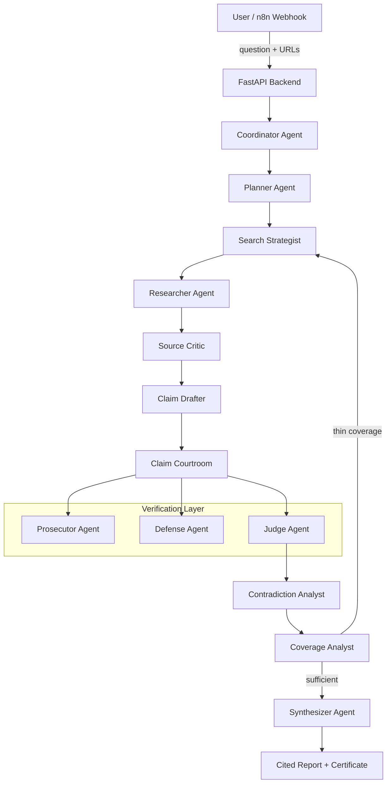
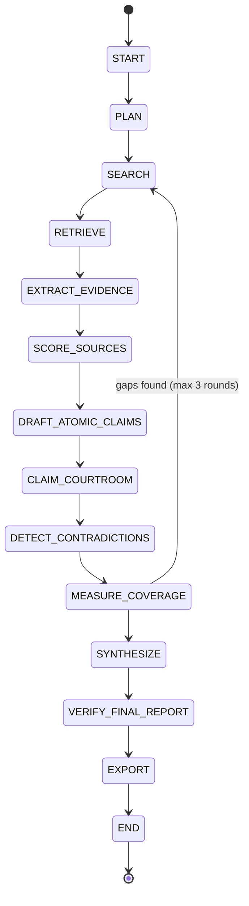
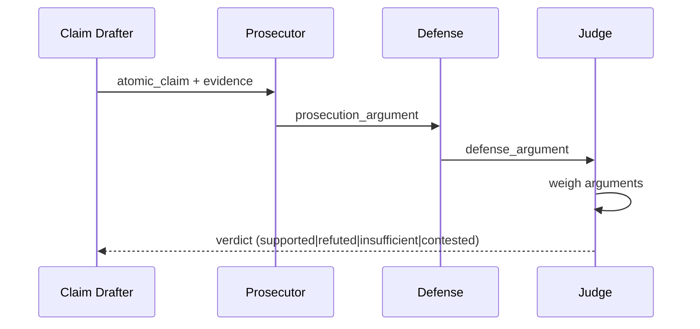
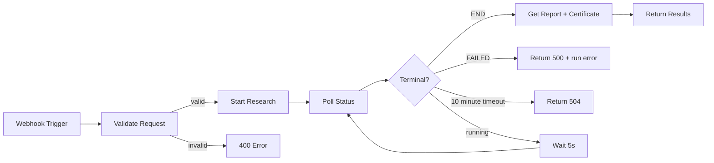
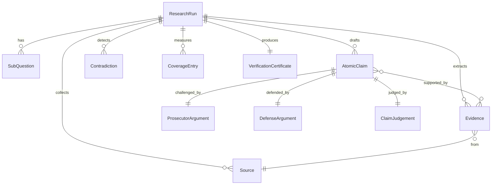

# DeepDive — Self-Verifying Research Analyst

A multi-agent research platform that investigates questions, verifies claims against sources, and produces auditable cited reports. Built for **Agent Arena 2026 — Track 01**.

## Architecture



## State Machine



## Claim Verification Sequence



## 12 Specialized Agents

| Agent | Role |
|-------|------|
| **Coordinator** | Orchestrates the full research pipeline |
| **Planner** | Decomposes questions into sub-questions |
| **Search Strategist** | Generates diverse search queries |
| **Researcher** | Extracts structured evidence from sources |
| **Source Critic** | Scores source credibility (0–1) |
| **Claim Drafter** | Produces atomic, verifiable claims |
| **Prosecutor** | Challenges each claim against evidence |
| **Defense** | Argues for claim validity |
| **Judge** | Issues structured verdicts |
| **Contradiction Analyst** | Detects inter-claim contradictions |
| **Coverage Analyst** | Maps coverage per sub-question |
| **Synthesizer** | Produces the final cited report |

## Mesh API Compliance

All LLM calls route through the **Mesh API** gateway (`https://api.meshapi.ai/v1`). No direct calls to OpenAI, Anthropic, Google, Cohere, or Hugging Face endpoints.

- **Gateway**: `app/core/mesh_gateway.py` — singleton `AsyncOpenAI` client with `base_url` override
- **Key**: `MESH_API_KEY` environment variable (prefix `rsk_`)
- **Model**: Configurable via `MESH_MODEL` (default: `anthropic/claude-haiku-5.5`)
- **Temperature**: 0 for deterministic outputs
- **Output**: JSON-only responses with Pydantic validation

### Anti-Drift Controls

- Pydantic schemas enforce structured output at every agent boundary
- Temperature 0 reduces sampling variance; provider behavior can still vary
- Content hashing on evidence prevents mutation
- Immutable original question threaded through all agents
- Max 3 research loop rounds with deterministic termination

## n8n Integration



Import `n8n/deepdive-research.json` into your n8n instance. Set `DEEPDIVE_BACKEND_URL` environment variable to point at your running DeepDive API.

## Data Model



## Installation

### React research workspace

The frontend in `frontend/` adapts the supplied shadcn design to real FastAPI data. It uses React 19, TanStack Query, generated file-based TanStack Router routes, Tailwind v4, IBM Plex fonts and Recharts. This deployment uses a static SPA served from FastAPI on the same HTTPS origin; no separate Lovable/SSR runtime is required.

Views: Report, Coverage, Courtroom, Audit, Contradictions, Sources and engineering Control Flow. The engineering view explains each stage's input/output, selected queries, source→passage→claim mappings, recorded loopbacks and browser API traces. New runs persist strategist payloads, selected query IDs, returned Brave URLs and extraction-input hashes; missing historical telemetry is explicitly labeled.

New research and follow-ups support bounded rounds and confidence thresholds. Report print/PDF uses the browser print dialog and includes a source-evidence appendix. Original runs retain their original certificate and any missing token/argument metadata. New Mesh calls record provider-returned token counts when supplied, and new runs persist courtroom arguments. Delete is disabled pending user authentication; this public workspace does not expose an unauthenticated destructive endpoint.

Local frontend development: `cd frontend`, `npm ci`, `npm run dev` (Vite proxies API requests to FastAPI on port 8000). Verification: `npm run build` and `npm test`. Docker's multi-stage build compiles the UI, checks TypeScript and runs frontend tests. FastAPI retains legacy Jinja views when a frontend build is absent.

Additive APIs: `GET /runs` lists stored runs; `GET /runs/{id}/workspace` returns frontend run details without raw agent response previews. Existing n8n status/report/certificate endpoints retain their response shapes. `/health` includes a real SQLite readiness check; Mesh configuration status is key presence, not an inference connectivity probe.

```bash
# Clone
git clone https://github.com/YOUR_USERNAME/deepdive.git
cd deepdive

# Environment
cp .env.example .env
# Edit .env and set MESH_API_KEY=rsk_your_key_here
# Optional autonomous search: BRAVE_SEARCH_API_KEY=your_key_here

# Install
pip install -r requirements.txt

# Run
uvicorn app.main:app --host 0.0.0.0 --port 8000
```

### Docker

```bash
docker compose up --build
```

## Testing

```bash
# All tests (no Mesh key required)
python -m pytest tests/ -v

# Individual suites
python -m pytest tests/test_schemas.py -v       # Data model tests
python -m pytest tests/test_security.py -v      # SSRF / sanitization
python -m pytest tests/test_evaluation.py -v    # Benchmark framework
python -m pytest tests/test_mesh_compliance.py -v  # Architecture compliance
```

## Evaluation

### Benchmark Suite

10 curated questions across categories: current market data, scientific claims, policy analysis, historical events, disputed topics, conflicting statistics, outdated sources, misleading headlines, unsupported forecasts, and insufficient evidence.

### Citation Mutation Test

5 mutation types generate adversarial claim/evidence pairs:
- **original**: Positive control
- **unrelated_swap**: Replace citation with unrelated evidence
- **similar_swap**: Replace citation with topically similar, non-supporting evidence
- **qualifier_removed**: Change approximate language into an exact assertion
- **inflated_statistic**: Alter first numeric value

### Metrics

- **Groundedness**: % of claims with verdict `supported`
- **Source diversity**: Unique domains cited
- **Contradiction detection rate**: Contradictions found per run
- **Coverage completeness**: % of sub-questions adequately covered
- **Mutation rejection rate**: % of evaluated citation mutations rejected

Latest deployed runtime and CI evidence: [`docs/release-evidence-2026-10-24.md`](docs/release-evidence-2026-10-24.md). Latest release validation: 116 backend tests and 22 frontend tests passed; these are not live model accuracy measurements.

Measured production results and limitations: [`docs/evaluation-results.md`](docs/evaluation-results.md).

Measured examples (2026-10-18): EV run `2ed2c8150b91476e` retrieved 6 sources and 34 evidence passages, accepting 6 of 12 claims with 7/7 valid citation links. AGI run `0d67c451657b4525` retrieved 4 sources and 19 passages, accepting 5 of 12 claims with 5/5 valid citation links. Both reports have incomplete coverage; citation integrity measures internal references, not independent truth.

The bounded live mutation evaluation rejected or downgraded 6/6 adversarial cases, with 0/6 false accepts and only 1/2 positive controls fully accepted. This small sample exposes conservative false rejection. The local automated suite recorded 73 passing tests; that count does not claim tests ran inside the production container.
Hackathon rule mapping: [`docs/hackathon-compliance.md`](docs/hackathon-compliance.md).
Prompt-reference review: [`docs/prompt-reference-review.md`](docs/prompt-reference-review.md).

## Security

- **SSRF Protection**: URL validation blocks private IPs, localhost, link-local, cloud metadata endpoints
- **HTML Sanitization**: Bleach-based tag/attribute allowlisting
- **Prompt Injection Filtering**: Strips common injection patterns from retrieved content
- **No secrets in source**: All credentials via environment variables

## API Endpoints

| Method | Path | Description |
|--------|------|-------------|
| GET | `/health` | Health check + Mesh connectivity |
| POST | `/research` | Start a research run |
| GET | `/runs/{id}` | Run status and state |
| GET | `/runs/{id}/audit` | Full audit trail |
| GET | `/runs/{id}/claims` | Claim verdicts |
| GET | `/runs/{id}/contradictions` | Detected contradictions |
| GET | `/runs/{id}/certificate` | Verification certificate |
| GET | `/runs/{id}/report` | Final synthesized report |
| POST | `/runs/{id}/follow-up` | Ask follow-up question |
| GET | `/runs/{id}/evaluation` | Deterministic metrics from persisted run artifacts |

## Project Structure

```
deepdive/
├── app/
│   ├── agents/
│   │   ├── prompts.py          # 12 agent system prompts
│   │   └── runner.py           # Agent execution functions
│   ├── api/
│   │   └── routes.py           # FastAPI route handlers
│   ├── core/
│   │   ├── config.py           # Pydantic settings
│   │   └── mesh_gateway.py     # Mesh API client
│   ├── evaluation/
│   │   └── benchmark.py        # Benchmark + mutation tests
│   ├── models/
│   │   └── schemas.py          # All Pydantic models
│   ├── services/
│   │   ├── orchestrator.py     # State machine orchestrator
│   │   ├── retrieval.py        # URL fetching + parsing
│   │   └── security.py         # SSRF + sanitization
│   ├── storage/
│   │   └── database.py         # SQLite persistence
│   ├── templates/
│   │   ├── dashboard.html      # Main UI
│   │   └── run_detail.html     # Run detail view
│   └── main.py                 # FastAPI app entry
├── tests/
│   ├── conftest.py
│   ├── test_schemas.py
│   ├── test_security.py
│   ├── test_evaluation.py
│   └── test_mesh_compliance.py
├── n8n/
│   └── deepdive-research.json  # n8n workflow
├── Dockerfile
├── docker-compose.yml
├── requirements.txt
├── .env.example
└── .github/workflows/
    ├── ci.yml
    └── agent-arena-2026-checks.yml
```

## License

MIT
