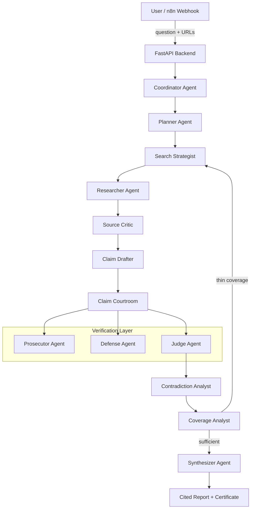
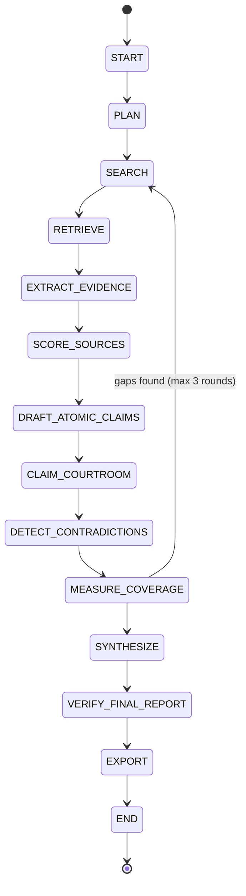
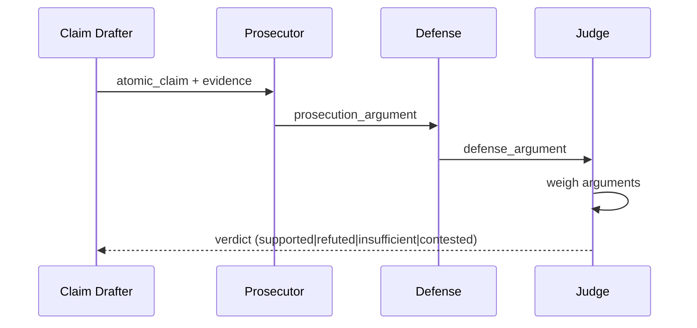
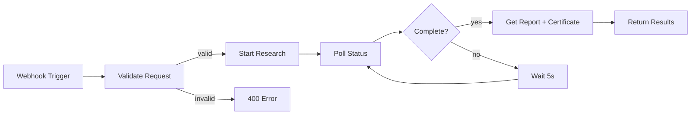
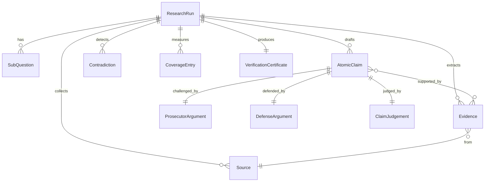

# DeepDive — Self-Verifying Research Analyst

A multi-agent research platform that investigates questions, verifies claims against sources, and produces auditable cited reports. Built for **Agent Arena 2026 — Track 01**.

## Architecture



## State Machine



## Claim Verification Sequence



## 12 Specialized Agents

| Agent | Role |
|-------|------|
| **Coordinator** | Orchestrates the full research pipeline |
| **Planner** | Decomposes questions into sub-questions |
| **Search Strategist** | Generates diverse search queries |
| **Researcher** | Extracts structured evidence from sources |
| **Source Critic** | Scores source credibility (0–1) |
| **Claim Drafter** | Produces atomic, verifiable claims |
| **Prosecutor** | Challenges each claim against evidence |
| **Defense** | Argues for claim validity |
| **Judge** | Issues structured verdicts |
| **Contradiction Analyst** | Detects inter-claim contradictions |
| **Coverage Analyst** | Maps coverage per sub-question |
| **Synthesizer** | Produces the final cited report |

## Mesh API Compliance

All LLM calls route through the **Mesh API** gateway (`https://api.meshapi.ai/v1`). No direct calls to OpenAI, Anthropic, Google, Cohere, or Hugging Face endpoints.

- **Gateway**: `app/core/mesh_gateway.py` — singleton `AsyncOpenAI` client with `base_url` override
- **Key**: `MESH_API_KEY` environment variable (prefix `rsk_`)
- **Model**: Configurable via `MESH_MODEL` (default: `gpt-4o-mini`)
- **Temperature**: 0 for deterministic outputs
- **Output**: JSON-only responses with Pydantic validation

### Anti-Drift Controls

- Pydantic schemas enforce structured output at every agent boundary
- Temperature 0 eliminates sampling variance
- Content hashing on evidence prevents mutation
- Immutable original question threaded through all agents
- Max 3 research loop rounds with deterministic termination

## n8n Integration



Import `n8n/deepdive-research.json` into your n8n instance. Set `DEEPDIVE_BACKEND_URL` environment variable to point at your running DeepDive API.

## Data Model



## Installation

```bash
# Clone
git clone https://github.com/YOUR_USERNAME/deepdive.git
cd deepdive

# Environment
cp .env.example .env
# Edit .env and set MESH_API_KEY=rsk_your_key_here

# Install
pip install -r requirements.txt

# Run
uvicorn app.main:app --host 0.0.0.0 --port 8000
```

### Docker

```bash
docker compose up --build
```

## Testing

```bash
# All tests (no Mesh key required)
python -m pytest tests/ -v

# Individual suites
python -m pytest tests/test_schemas.py -v       # Data model tests
python -m pytest tests/test_security.py -v      # SSRF / sanitization
python -m pytest tests/test_evaluation.py -v    # Benchmark framework
python -m pytest tests/test_mesh_compliance.py -v  # Architecture compliance
```

## Evaluation

### Benchmark Suite

10 curated questions across categories: current market data, scientific claims, policy analysis, historical events, disputed topics, conflicting statistics, outdated sources, misleading headlines, unsupported forecasts, and insufficient evidence.

### Citation Mutation Test

5 mutation types verify the system catches tampered citations:
- **swap_source**: Attribute evidence to wrong source
- **inflate_confidence**: Artificially raise confidence scores
- **remove_citation**: Strip source references
- **fabricate_source**: Inject non-existent sources
- **alter_quote**: Modify quoted evidence text

### Metrics

- **Groundedness**: % of claims with verdict `supported`
- **Source diversity**: Unique domains cited
- **Contradiction detection rate**: Contradictions found per run
- **Coverage completeness**: % of sub-questions adequately covered
- **Mutation detection rate**: % of citation mutations caught

## Security

- **SSRF Protection**: URL validation blocks private IPs, localhost, link-local, cloud metadata endpoints
- **HTML Sanitization**: Bleach-based tag/attribute allowlisting
- **Prompt Injection Filtering**: Strips common injection patterns from retrieved content
- **No secrets in source**: All credentials via environment variables

## API Endpoints

| Method | Path | Description |
|--------|------|-------------|
| GET | `/health` | Health check + Mesh connectivity |
| POST | `/research` | Start a research run |
| GET | `/runs/{id}` | Run status and state |
| GET | `/runs/{id}/audit` | Full audit trail |
| GET | `/runs/{id}/claims` | Claim verdicts |
| GET | `/runs/{id}/contradictions` | Detected contradictions |
| GET | `/runs/{id}/certificate` | Verification certificate |
| GET | `/runs/{id}/report` | Final synthesized report |
| POST | `/runs/{id}/follow-up` | Ask follow-up question |
| POST | `/evaluate` | Run benchmark suite |

## Project Structure

```
deepdive/
├── app/
│   ├── agents/
│   │   ├── prompts.py          # 12 agent system prompts
│   │   └── runner.py           # Agent execution functions
│   ├── api/
│   │   └── routes.py           # FastAPI route handlers
│   ├── core/
│   │   ├── config.py           # Pydantic settings
│   │   └── mesh_gateway.py     # Mesh API client
│   ├── evaluation/
│   │   └── benchmark.py        # Benchmark + mutation tests
│   ├── models/
│   │   └── schemas.py          # All Pydantic models
│   ├── services/
│   │   ├── orchestrator.py     # State machine orchestrator
│   │   ├── retrieval.py        # URL fetching + parsing
│   │   └── security.py         # SSRF + sanitization
│   ├── storage/
│   │   └── database.py         # SQLite persistence
│   ├── templates/
│   │   ├── dashboard.html      # Main UI
│   │   └── run_detail.html     # Run detail view
│   └── main.py                 # FastAPI app entry
├── tests/
│   ├── conftest.py
│   ├── test_schemas.py
│   ├── test_security.py
│   ├── test_evaluation.py
│   └── test_mesh_compliance.py
├── n8n/
│   └── deepdive-research.json  # n8n workflow
├── Dockerfile
├── docker-compose.yml
├── requirements.txt
├── .env.example
└── .github/workflows/ci.yml
```

## License

MIT
