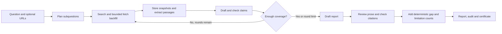
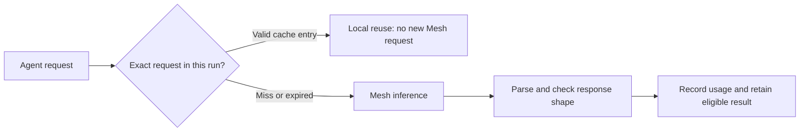

# DeepDive: the simple flow

Runtime `26907d9` is deployed. See [offline fixes and release evidence](pre-action3-fixes-2026-10-25.md) for measured checks and limitations.

Ask a question. DeepDive finds source material, checks claims against it and shows what survived. A report can be partial. It is not a truth guarantee or independent human certification.

## What happens

1. **Plan:** split the question into subquestions and completion criteria.
2. **Search:** Brave returns URLs. Protected HTTP retrieval stores sanitized snapshots, hashes and selected text offsets. Challenges/error pages are withheld when detected. Failed fetches can promote queued alternatives within separate success/attempt limits. Unfetched alternatives carry to later rounds; safe HTTP outcomes are logged.
3. **Extract:** researcher returns passages that must match supplied source text. Each passage links to its source and subquestion.
4. **Check claims:** drafter proposes atomic claims. Prosecutor challenges them, Defense maps exact quotes and Judge sees the original linked passages. Unsupported or low-confidence claims are withheld. Next-round drafter receives bounded, attributed critiques; these are feedback, not evidence.
5. **Find gaps:** coverage reports missing areas. Later rounds target weak questions and can select a different bounded source window. A round limit can end research with unresolved gaps.
6. **Review report:** synthesizer uses accepted claims. Report Verifier reviews every non-empty generated line, including factual headings. Citation checks run afterward. Deterministic limitations from saved coverage/counts are appended separately from model prose. Missing/malformed decisions withhold affected text; a labelled accepted-claim fallback may be needed.
7. **Inspect:** UI shows report, coverage, courtroom, audit, contradictions, sources and control flow. The internal certificate describes recorded checks and limitations.

## How caching saves work

The key includes full messages, agent, prompt version, model, generation settings and endpoint. Entries are scoped to one run, expire after five minutes and are limited to 128. Changed evidence is not treated as an identical request. There is no semantic or cross-run answer cache.

Audit distinguishes local reuse from actual API requests. A local cache event's zero token increment means this app sent no new inference request; it is not a provider billing statement. Provider cached-input fields are retained only when returned. Missing historical measurements remain unavailable. New calls record cache lookup reasons separately from storage outcomes; a full cache stops insertion without eviction. First guarded live evaluation measured zero cache hits across 20 Mesh calls; no positive savings established. See [measured results](action2-n8n-results-2026-10-24.md).

## Where n8n fits

The 14-node workflow accepts a webhook, validates input, starts research, polls status, then fetches report/certificate and responds. It handles failure and timeout branches. It does not perform AI inference itself; all AI roles use the backend's Mesh gateway. Changing workflow JSON does not deploy backend code.

## Example

Question: “What are EV battery investment risks in 2026?” A good run gathers dated primary material for demand, policy, technology, raw materials and execution risks. If policy evidence is missing, Coverage must show a gap instead of inventing that section. A historical statistic must retain its study date; an older result is not automatically current evidence.

An END state does not mean complete coverage. A blank contradiction list does not establish agreement. Journal/preprint copies may be grouped as duplicate material; title-based grouping remains heuristic.

## Storage and deployment

- SQLite persists runs, passages, snapshots, decisions, usage and audit records in a bind-mounted data directory.
- No vector database is implemented. SQLite is not vector retrieval.
- Deployment requires exact-revision tests/build, copied-database validation, browser checks, an active-run check, consistent backup and rollback.
- Historical reports are preserved. New code does not retroactively re-verify old runs.
- Evaluation reservations are separate from confirmed billing. Public production requests are not automatically capped by the evaluation-only guard.
- Physical Android verification and automatic crash resume are not implemented/proven.

See [release evidence](pre-action3-fixes-2026-10-25.md), [cache details](token-optimization-2026-10-24.md) and [pending validation](current-pending-2026-10-24.md). These documents distinguish completed checks from pending work. Hackathon submission stays on hold until explicit approval.
