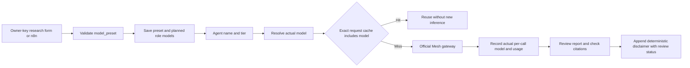

# Model tiering, catalog rates and verification disclaimer

Implemented without paid inference or Brave calls. The provided suggestion was adapted to current code: runners already identify their agent; coordinator is Python, not an AI role; report_verifier is the twelfth AI role and receives the heavy tier. Routing labels express policy, not independently measured speed/quality.

## Routing

| Preset | Heavy | Medium/light |
|---|---|---|
| fast | openai/gpt-4o-mini | openai/gpt-4o-mini |
| balanced (new request default) | openai/gpt-4o | openai/gpt-4o-mini |
| quality | openai/gpt-4o | openai/gpt-4o |
| configured | MESH_MODEL | MESH_MODEL |

Heavy: prosecutor, judge, synthesizer, report_verifier. Medium: planner, defense, claim_drafter, coverage_analyst. Light: search_strategist, researcher, source_critic, contradiction_analyst. All inference still passes through the existing official Mesh-only gateway. These lighter-role assignments are not proof that cheaper models preserve extraction/scoring/contradiction quality.



Preset is held in a ContextVar scoped to the research task, restored in finally, including failed runs. Concurrent runs cannot replace each other's preset. Unknown/missing agent names use medium within a preset; explicit internal model overrides still win. Unscoped legacy gateway calls and the configured preset preserve MESH_MODEL. New requests default to balanced. Historical runs missing preset remain null/Not recorded, never retroactively labeled balanced.

The existing exact-request cache already keys on model and complete request settings. Changed resolved model cannot reuse a different model's response. If two presets resolve to the identical full request/model, reuse remains valid. No cross-run semantic cache is introduced.

## Cost transparency

Exact IDs and catalog rates were checked using authenticated, non-inference GET to https://api.meshapi.ai/v1/models on October 25, 2026. The endpoint returns a top-level list; parsing was corrected after inspecting its schema. Credentials were neither logged nor stored in the repository.

| Model | Catalog input USD / 1M tokens | Catalog output USD / 1M tokens |
|---|---:|---:|
| openai/gpt-4o-mini | 0.15 | 0.60 |
| openai/gpt-4o | 2.50 | 10.00 |

[Saved metadata](evaluations/model-catalog-2026-10-25.json) and [runtime catalog snapshot](../app/core/model_catalog.json) record the check time and source. Catalog presence is not a live completion/JSON-capability test. Prices may change; snapshot rates are not actual bills and do not include unknown discounts, retries, search, or other services. Configured models outside this small verified snapshot show an unavailable rate, not zero.

The suggestion's $0.10–0.90 run ranges and 45–180 second durations were not measured, so they are not shipped. API fields est_cost_per_run and est_time are null. UI states not calibrated and shows input/output catalog rates. No claim of saved money, reduced latency or higher accuracy is made. Token counters still use provider-returned usage; this feature does not create a durable cost ledger or spend enforcement.

## API and n8n

`GET /model-presets` returns labels, descriptions, resolved tier models, catalog snapshot rates/time, a pricing caveat, and default balanced. It makes no network/inference call at runtime. Owner authentication remains required on research/follow-up. Example request body:

```json
{"question":"What does the published evidence establish?","source_urls":[],"max_rounds":2,"confidence_threshold":0.7,"model_preset":"balanced"}
```

Preset is a validated enum. Unsupported values receive 422; client arbitrary model IDs are not accepted. Research/follow-up passes the selected value to background orchestration and persists it before work begins. Follow-up makes an explicit selection (default balanced), not an undocumented parent-policy inheritance. `/runs/{id}` and workspace expose the saved selection; workspace includes planned mappings; Audit shows actual per-call models. The n8n JSON forwards caller model_preset, defaulting to balanced, while retaining owner-key forwarding and fourteen nodes.

Research form loads options from the API and stays disabled if metadata is unavailable. Access key stays out of research JSON and AI inputs. Updated evaluation launch controllers must review selected-model pricing/budget assumptions before any later paid test; no existing evaluation code or budget ledger was changed in this implementation.

## Verification disclosure

Report and certificate response models expose verification_disclaimer. New generated reports append a deterministic verification note after model review and strict citation filtering, with the actual recorded review status. This note is application metadata, not another source-backed factual claim. Appending during synthesis would risk filtering it out or wrongly marking it AI-verified, so the change is made after filtering rather than in runner.py.

Report UI always shows a muted disclosure below the content, including legacy reports. `/report` includes the disclosure and actual review status; `/certificate` includes the disclosure. The wording says reviewer may share model/provider with drafting rather than asserting it always does. It is neither a hallucination-free guarantee nor independent human verification. Historical stored report text and certificates are not rewritten; their API/UI disclosure is additive on read.

## Verification and rollout status

Local backend: **288 passed, one Windows fcntl skip**. Frontend: **34 passed**. Vite/TypeScript build passed with the existing dashboard chunk warning. Checks include all four presets and twelve roles, explicit/unknown-role routing, concurrent task isolation, cache/model separation, exception cleanup, request/follow-up persistence and dispatch, the full mocked API-to-report pipeline, legacy null preservation, certificate/report disclosures, selector header/body separation, and failed metadata loading.

Local browser preview used a clearly labeled COPY of the historical Action 3 fixture, with Mesh/Brave/owner keys cleared and research locked. All four selector choices, token rates, unknown configured-model rate, disclaimer, and historical Audit labeling were inspected. No new research result was generated.

This change is implemented and tested on the draft branch; production deployment and active n8n workflow are not changed by this implementation. No tiered paid run or comparative quality/speed/cost benchmark was performed. Production stays on its existing owner-key-protected release until a later rollout. Submission and application merge remain on hold.
